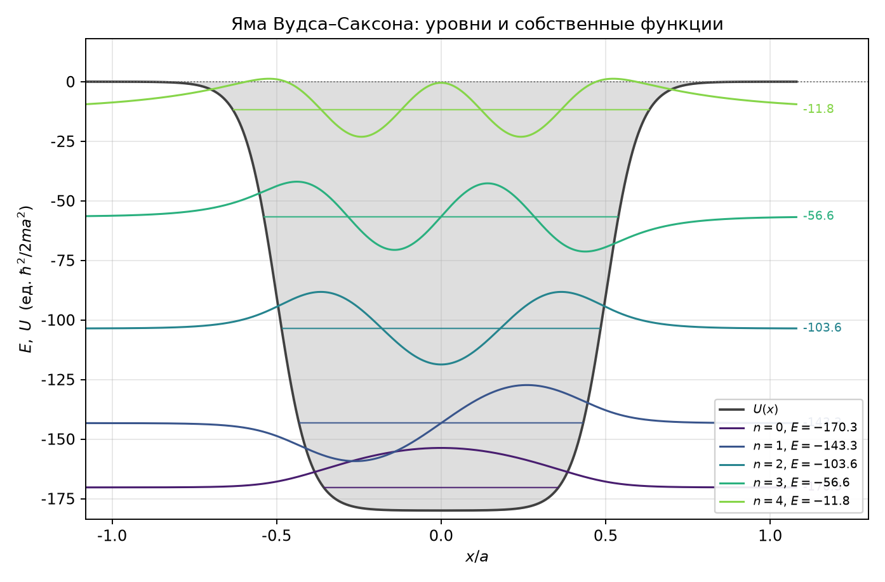
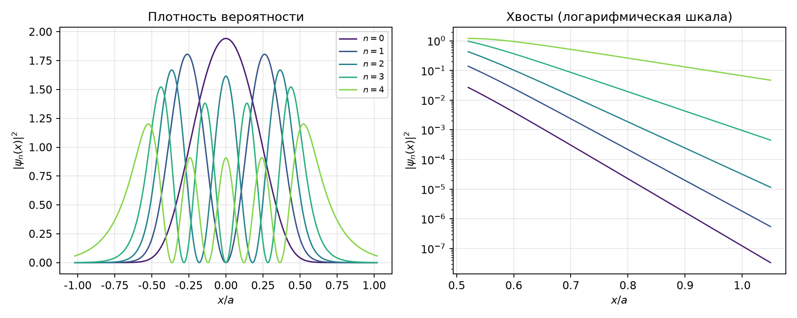
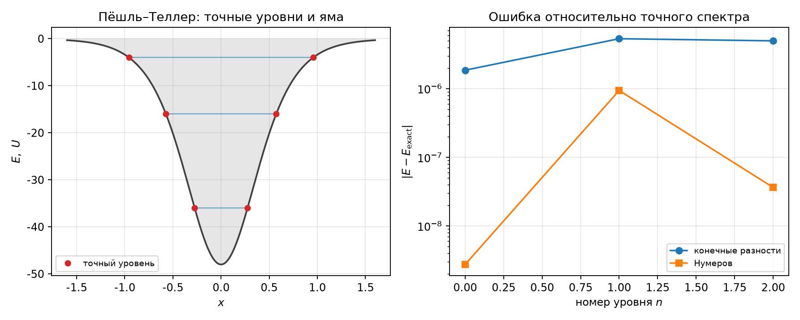
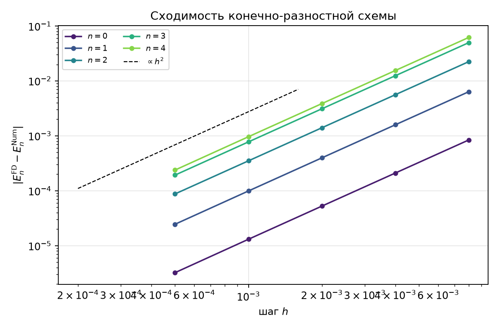
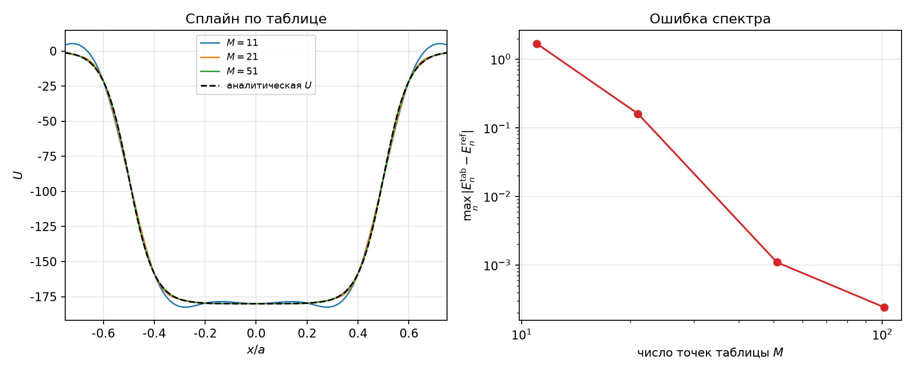
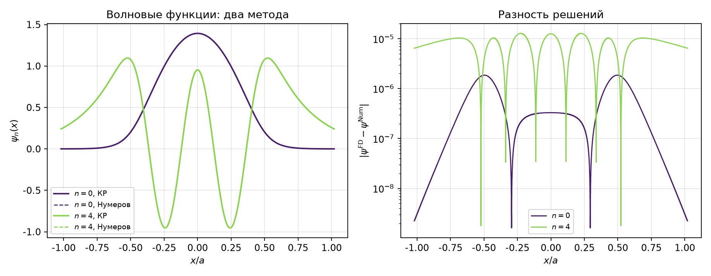

# Связные состояния в потенциальной яме Вудса–Саксона

**Задание.** Используя уравнение Шрёдингера, найти связные состояния и соответствующие им собственные значения для потенциальной ямы произвольной формы $U(x)$, заданной аналитически или таблично на отрезке $[0,a]$, где $a$ — ширина ямы. Построить графически собственные функции.

**Что сделано.** Выбрана гладкая яма Вудса–Саксона — реалистичный потенциал среднего поля атомного ядра. Для неё найдены все пять связанных состояний двумя независимыми численными методами (конечные разности и метод Нумерова со сшивкой), проведена проверка на потенциале Пёшль–Теллера с известным точным спектром, исследованы сходимость и чувствительность к табличному заданию потенциала, выполнен перевод результатов в ядерные единицы. Все вычисления собраны в исполненном ноутбуке [task1_woods_saxon.ipynb](task1_woods_saxon.ipynb).

## 1. Выбор потенциала

Использована яма Вудса–Саксона

$$
U(x)=-\frac{U_0}{1+\exp\!\big((|x|-R)/d\big)},
$$

где $U_0$ — глубина, $R$ — радиус на полуглубине, $d$ — диффузность (ширина кромки). Ширина ямы на полувысоте равна $a=2R$.

Причины выбора:

* это не «учебная» прямоугольная или параболическая яма: форма гладкая, с плоским дном и двумя кромками, поэтому задача действительно соответствует «яме произвольной формы»;
* потенциал имеет прямое физическое происхождение — это среднее поле нуклонов в ядре, так что результаты допускают содержательную интерпретацию;
* функция аналитична на всей оси и не требует искусственного обрезания, что позволяет довести численную схему до чистого второго порядка точности;
* метод решения не привязан к конкретной $U(x)$: в модуле `schrodinger_well.py` потенциал передаётся как вызываемый объект, поэтому та же программа решает задачу для любой аналитической или таблично заданной ямы.

Параметры (в единицах ширины ямы $a$): $U_0=180$, $R=0{,}5a$, $d=0{,}05a$. Вне ямы потенциал экспоненциально стремится к нулю, поэтому связанные состояния имеют энергию $E<0$.

## 2. Постановка задачи

Одномерное стационарное уравнение Шрёдингера

$$
-\frac{\hbar^2}{2m}\psi''+U(x)\psi=E\psi
$$

записано в безразмерных единицах $\hbar^2/(2m)=1$, $a=1$:

$$
-\psi''+U(x)\psi=E\psi,\qquad E<0 .
$$

Искомые состояния нормированы:

$$
\int_{-\infty}^{\infty}|\psi(x)|^2\,dx=1 .
$$

На бесконечности функция должна затухать: $\psi\to 0$ при $|x|\to\infty$. Поскольку $U(-x)=U(x)$, решения обладают определённой чётностью; это используется и для контроля, и для ускорения расчёта.

Полуклассическая оценка числа связанных состояний

$$
N\approx\frac{1}{\pi}\int\sqrt{|U(x)|}\,dx
$$

даёт $N\approx 4{,}9$, то есть следует ожидать пять уровней.

## 3. Численные методы

### 3.1. Конечно-разностная схема

На равномерной сетке $x_j=-L+(j+\tfrac12)h$, $j=0,\dots,N-1$ (узлы в центрах ячеек, $L=3a$, $N=12000$), уравнение аппроксимируется симметричной разностью:

$$
-\frac{\psi_{j+1}-2\psi_j+\psi_{j-1}}{h^2}+U_j\psi_j=E\psi_j .
$$

Условия $\psi(\pm L)=0$ реализуются через фиктивные узлы. Получается симметричная трёхдиагональная матрица; все собственные значения $E<0$ находятся за один вызов `scipy.linalg.eigh_tridiagonal`. Схема имеет второй порядок точности, $O(h^2)$, а собственные функции нормируются по правилу трапеций. Чётность и число узлов определяются по найденному вектору.

### 3.2. Метод Нумерова со сшивкой

Уравнение приводится к виду $\psi''=f\psi$, $f=U-E$, и интегрируется схемой Нумерова четвёртого порядка:

$$
\psi_{j+1}=\frac{(2+10cf_j)\psi_j-(1-cf_{j-1})\psi_{j-1}}{1-cf_{j+1}},
\qquad c=\frac{h^2}{12}.
$$

Решение строится с двух сторон: наружу из центра (с учётом чётности) и внутрь с внешней границы по затухающему хвосту $\psi\propto e^{-\kappa x}$, $\kappa=\sqrt{-E}$. В точке сшивки $x_m$ приравниваются логарифмические производные; для устойчивости используется кросс-произведение (вронскиан)

$$
W(E)=\psi'_{\text{out}}(x_m)\psi_{\text{in}}(x_m)-\psi'_{\text{in}}(x_m)\psi_{\text{out}}(x_m)=0 .
$$

Корни $W(E)$ находятся сканированием по энергии с уточнением методом Брента. Односторонняя стрельба в запрещённую область здесь непригодна: ошибка возбуждает экспоненциально растущую моду, и условие сшивки становится экспоненциально узким по энергии, что приводит к ложным корням и зависимости уровней от шага. Двусторонняя схема от этого свободна. Шаг Нумерова $h=5\cdot10^{-4}a$, область интегрирования $|x|\le 3a$, точка сшивки $x_m=0{,}2a$ внутри классически разрешённой области.

## 4. Результаты

В яме укладывается пять связанных состояний. Энергии приведены в единицах $\hbar^2/(2ma^2)$; последний столбец — ядерный масштаб (см. разд. 7).

| $n$ | чётность | узлы | $E$ (КР) | $E$ (Нумеров) | $E_{\text{КР}}-E_{\text{Нум}}$ | $E$, МэВ |
|---:|:--------:|-----:|---------:|--------------:|------------------------------:|---------:|
| 0 | чётная | 0 | −170,285459 | −170,285456 | −3,2·10⁻⁶ | −48,83 |
| 1 | нечётная | 1 | −143,294805 | −143,294781 | −2,5·10⁻⁵ | −41,09 |
| 2 | чётная | 2 | −103,582880 | −103,582792 | −8,8·10⁻⁵ | −29,71 |
| 3 | нечётная | 3 | −56,631791 | −56,631598 | −1,9·10⁻⁴ | −16,24 |
| 4 | чётная | 4 | −11,788764 | −11,788525 | −2,4·10⁻⁴ | −3,38 |

Уровни чередуются по чётности, а число узлов совпадает с номером состояния — выполняется теорема Штурма. Основной уровень лежит на $94{,}6\%$ глубины, верхний — всего на $6{,}5\%$, поэтому его функция заметно выходит в хвосты потенциала.



*Рис. 1.* Потенциал, уровни энергии и собственные функции. Горизонтальные отрезки — классически разрешённая область между точками поворота $U(\pm x_t)=E$; функции смещены по вертикали на свои энергии.



*Рис. 2.* Слева — плотности $|\psi_n|^2$; справа — их хвосты в полулогарифмическом масштабе. Прямые линии подтверждают экспоненциальное затухание $\psi\propto e^{-\kappa|x|}$; наклон тем меньше, чем ближе уровень к нулю.

## 5. Проверка на точном решении

Для контроля обеих схем использован потенциал Пёшль–Теллера

$$
U(x)=-\frac{\alpha^2\lambda(\lambda+1)}{\cosh^2(\alpha x)},
\qquad E_n=-\alpha^2(\lambda-n)^2,\quad n<\lambda ,
$$

допускающий точное аналитическое решение. При $\alpha=2$, $\lambda=3$ точные уровни равны $-36$, $-16$, $-4$.

| $n$ | $E_{\text{точн}}$ | $E_{\text{КР}}$ | ошибка КР | $E_{\text{Нум}}$ | ошибка Нумерова |
|---:|------------------:|----------------:|----------:|-----------------:|----------------:|
| 0 | −36 | −36,000002 | 1,9·10⁻⁶ | −36,000000 | 2,8·10⁻⁹ |
| 1 | −16 | −16,000005 | 5,3·10⁻⁶ | −16,000001 | 9,4·10⁻⁷ |
| 2 | −4 | −4,000005 | 5,0·10⁻⁶ | −4,000000 | 3,6·10⁻⁸ |



*Рис. 3.* Слева — потенциал и найденные уровни (точки — аналитические значения). Справа — ошибка относительно точного спектра; обе схемы дают порядка $10^{-6}$ и лучше.

## 6. Сходимость и табличное задание потенциала

### 6.1. Сходимость по шагу

Конечно-разностные энергии сравнивались с эталоном Нумерова при $h=5\cdot10^{-4}a$:

| $h$ | ошибка $n=0$ | ошибка $n=1$ | ошибка $n=2$ | ошибка $n=3$ | ошибка $n=4$ |
|----:|-------------:|-------------:|-------------:|-------------:|-------------:|
| $8\cdot10^{-3}$ | 8,4·10⁻⁴ | 6,4·10⁻³ | 2,2·10⁻² | 5,0·10⁻² | 6,2·10⁻² |
| $2\cdot10^{-3}$ | 5,3·10⁻⁵ | 4,0·10⁻⁴ | 1,4·10⁻³ | 3,1·10⁻³ | 3,9·10⁻³ |
| $5\cdot10^{-4}$ | 3,2·10⁻⁶ | 2,5·10⁻⁵ | 8,8·10⁻⁵ | 1,9·10⁻⁴ | 2,4·10⁻⁴ |

При уменьшении шага вдвое ошибка падает примерно в 16 раз, что подтверждает второй порядок $O(h^2)$.



*Рис. 4.* Ошибка конечно-разностных уровней в зависимости от шага (лог–лог); штриховая линия — наклон $\propto h^2$.

### 6.2. Потенциал, заданный таблицей

Чтобы проверить требование о таблично заданной $U(x)$, потенциал сэмплировался в $M$ равноотстоящих точках отрезка $[0,2a]$, интерполировался кубическим сплайном и вне отрезка полагался нулём; затем решалась та же задача.

| $M$ | $\max|U_{\text{таб}}-U|$ | $\max_n|E_n^{\text{таб}}-E_n^{\text{эт}}|$ |
|----:|-------------------------:|------------------------------------------:|
| 11 | 11,0 | 1,7 |
| 21 | 2,67 | 1,6·10⁻¹ |
| 51 | 3,9·10⁻² | 1,1·10⁻³ |
| 101 | 1,6·10⁻³ | 2,4·10⁻⁴ |



*Рис. 5.* Слева — сплайн по таблице при разном числе точек; справа — ошибка спектра. При $M\gtrsim 50$ табличное задание воспроизводит спектр с точностью порядка конечно-разностной погрешности. При $M=11$ сглаживается кромка ямы, и ошибка достигает единиц.

### 6.3. Совпадение волновых функций



*Рис. 6.* Собственные функции нижнего и верхнего состояний по двум методам (слева) и их разность (справа). Максимальное расхождение не превышает $10^{-5}$; провалы в разности приходятся на нули $\psi$, где мала сама функция.

## 7. Физический масштаб

Для ядра типа $^{40}$Ca приняты $a=8{,}5$ фм ($R=4{,}25$ фм, $d=0{,}425$ фм), масса нейтрона, $\hbar^2/(2m)=20{,}72$ МэВ·фм². Тогда единица энергии $\hbar^2/(2ma^2)=0{,}287$ МэВ, а глубина $U_0=180$ отвечает $51{,}6$ МэВ — вблизи типичного значения $50$ МэВ.

| $n$ | $E$, МэВ | $\kappa$, фм⁻¹ | длина затухания $1/\kappa$, фм |
|---:|---------:|---------------:|-------------------------------:|
| 0 | −48,83 | 1,535 | 0,651 |
| 1 | −41,09 | 1,408 | 0,710 |
| 2 | −29,71 | 1,197 | 0,835 |
| 3 | −16,24 | 0,885 | 1,130 |
| 4 | −3,38 | 0,404 | 2,476 |

Полученные уровни по порядку величины соответствуют уровням нейтрона в ядре, а длина затухания хвоста растёт при приближении энергии к нулю — верхнее состояние простирается далеко за пределы ядра.

## 8. Выводы

1. В яме Вудса–Саксона с параметрами $U_0=180$, $R=0{,}5a$, $d=0{,}05a$ найдено пять связанных состояний; это согласуется с полуклассической оценкой $N\approx4{,}9$.
2. Уровни чередуются по чётности, число узлов совпадает с номером состояния, функции нормированы на единицу.
3. Две независимые схемы (конечные разности и Нумеров) дают совпадающие спектры и волновые функции; на потенциале Пёшль–Теллера обе воспроизводят точный спектр с ошибкой порядка $10^{-6}$.
4. Конечно-разностная схема демонстрирует сходимость $O(h^2)$; метод Нумерова при $h=5\cdot10^{-4}a$ стабилизирован на уровне $10^{-6}$.
5. Табличное задание потенциала (кубический сплайн по $M$ точкам) воспроизводит спектр при $M\gtrsim50$; при $M=11$ сглаживается кромка ямы и ошибка возрастает.
6. При ядерном масштабе $a=8{,}5$ фм уровни лежат при $-48{,}8$, $-41{,}1$, $-29{,}7$, $-16{,}2$ и $-3{,}4$ МэВ, что по порядку величины соответствует уровням нейтрона в ядре.

## 9. Структура работы и воспроизводимость

```
task1_woods_saxon/
├── task1_woods_saxon.ipynb   # исполненный ноутбук: теория, расчёты, графики, выводы
├── schrodinger_well.py       # модуль: потенциалы, схема КР, метод Нумерова, табулирование
├── REPORT.md                 # настоящий отчёт
├── figures/                  # fig1…fig6 (png)
└── results/                  # spectrum.csv, validation_poschl_teller.csv,
                              # convergence.csv, tabulation.csv, physical_scale.csv
```

Ноутбук использует виртуальное окружение в корне репозитория (Python 3.12, numpy, scipy, matplotlib, nbconvert):

```bash
../../.venv/bin/python -m nbconvert --to notebook --execute --inplace \
    --ExecutePreprocessor.timeout=1200 task1_woods_saxon.ipynb
```

Все таблицы отчёта получены из CSV-файлов в `results/`, все рисунки — из ноутбука.
